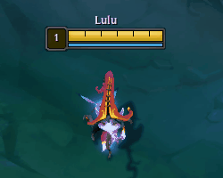

<p align="center">
  
</p>

<p align="center">
  <a href="https://github.com/kottaJS/Zhonyas/raw/main/Zhonyas.exe">
    
  </a>
</p>

<p align="center">
  
</p>

<p align="center">
  <a href="#"></a>
  <a href="#"></a>
  <a href="#"></a>
  <a href="#"></a>
</p>

---

> [!NOTE]
> **Vanguard Safety:** Zhonyas operates strictly at the Windows Firewall level (Windows COM API). It does not inject code, read memory, or hook game APIs. It does not trigger anti-cheat bans.

---

## Why Zhonyas?

Ever locked in your champion, only to suddenly realize you desperately need to use the bathroom, grab a quick snack, or pour yourself an ice-cold glass of Coke?

We’ve all been there. But League of Legends loading screens are dangerously fast nowadays. You sprint across your house, rush back in pure panic, and boom: you're 45 seconds late to lane, the enemy laner crashed a double wave, and your team is already spam-pinging your missing champion.

**Zhonyas fixes that.** It temporarily freezes your loading screen connection, gracefully holding the entire lobby so you can take your break without stressing, Alt+F4ing, or risking an AFK remake.

*(Sure, you're holding 9 other players hostage in loading screen limbo while they stare at a frozen 90% bar wondering whose fault it is, but that's a small price to pay).*

---

## Features

- **Auto-Loop:** Detects when your game starts, stalls the loading screen, unblocks in-game, and re-arms automatically for your next match.
- **Auto-Dismiss Connection Dialog:** If Riot shows the "Connection Error" timeout popup during longer stalls, Zhonyas automatically dismisses it upon unfreezing so your game connects seamlessly.
- **Duration Presets:**
  - `1 min (Very Safe)`
  - `2 min (Safe)`
  - `3 min (Safe)`
  - `3.5 min (Recommended)`
  - `4 min (Risky - Match may start)`
  - `5 min (Danger - Remake risk)`
- **Multi-Language Support:** English, Español, Português, 中文, 한국어, and 日本語.
- **Audio Alerts:** Sound cues on start, at 10 seconds remaining, and upon unfreeze.
- **Standalone:** Single `.exe` with all assets embedded inside. No installation required.
- **100% Open Source:** Licensed under GNU General Public License v3.0 (GPL-3.0).

---

## How to Use

1. [**Download Zhonyas.exe**](https://github.com/kottaJS/Zhonyas/raw/main/Zhonyas.exe)
2. Right-click and **Run as Administrator** *(required for firewall rules)*.
3. Select your duration and click **Start** (or leave auto-loop active).
4. Launch League of Legends.

---

## Building from Source

To build from source using Visual Studio or the .NET CLI:

```cmd
git clone https://github.com/kottaJS/Zhonyas.git
cd Zhonyas
dotnet build src/Zhonyas.csproj -c Release
```

---

## FAQ

**Can I get banned?**  
No. Zhonyas does not touch game memory or modify files. It only configures local Windows Firewall rules.

**Does it affect Discord or other apps?**  
No. Only LoL game server traffic is paused. Discord, browser, and music continue normally.

**Why does it need Admin?**  
Windows requires administrator permissions to add and remove firewall rules.

**How do I reconnect early?**  
Click **Reconnect** at any time.

---

## License

This project is licensed under the [GNU General Public License v3.0](LICENSE).
